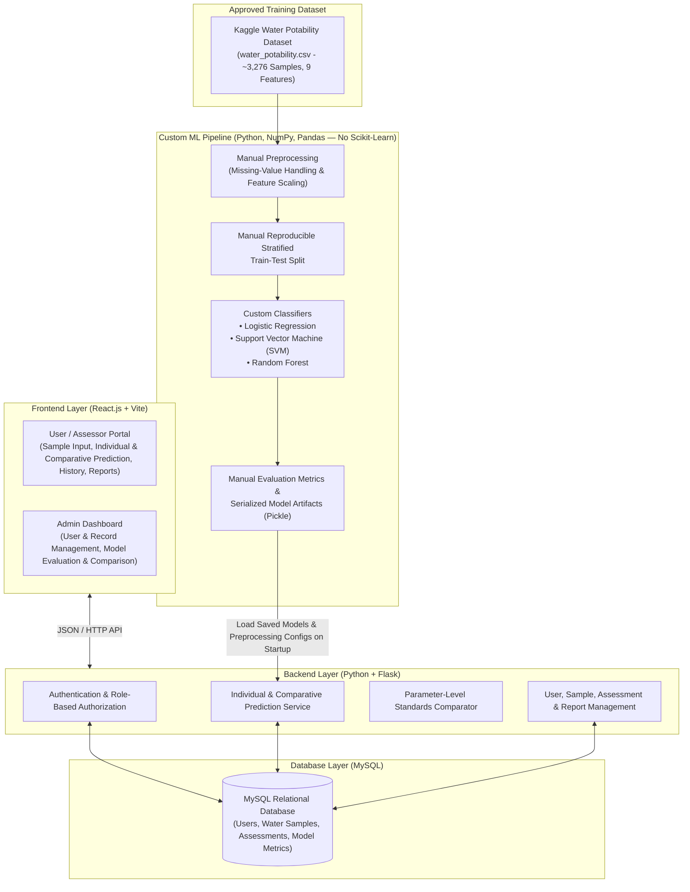

# Purity: Water Quality Classification and Potability Prediction System

> **Academic Context:** BCA, 8th Semester, Tribhuvan University – Project III  
> **Domain:** Applied Machine Learning & Web Application Development  
> **Reference Standards:** Nepal National Drinking Water Quality Standards (NDWQS) 2079 & World Health Organization (WHO) Guidelines

[](https://react.dev/)
[](https://flask.palletsprojects.com/)
[](https://www.mysql.com/)
[](https://www.python.org/)

---

## Executive Summary

**Purity: Water Quality Classification and Potability Prediction System** is an academic machine learning and web-based decision-support project developed for **BCA, 8th Semester, Tribhuvan University – Project III**. The system is designed to classify drinking water quality and predict potability from nine standard physicochemical water parameters using supervised binary classification algorithms implemented from scratch in Python.

In Nepal, rapid urbanization, aging distribution networks, shallow aquifer vulnerability, and seasonal monsoon runoff pose persistent challenges to drinking water safety across municipal supplies, tube wells, traditional stone spouts (*dhunge dharas*), and commercial water distribution. While comprehensive laboratory testing remains indispensable, preliminary screening of physical and chemical indicators can help identify potential water quality risks.

Purity combines a **React.js (Vite)** frontend, a **Python (Flask)** backend, a **MySQL** relational database, and custom-implemented machine learning classifiers (**Logistic Regression**, **Support Vector Machine**, and **Random Forest**—built without Scikit-learn) to support individual and side-by-side comparative potability predictions, alongside parameter-level reference comparisons against established drinking water standards.

> **Important Disclaimer:** This system is an academic decision-support and educational tool. Prediction outputs and probability estimates do not guarantee water safety and **do not replace certified laboratory water testing** or microbiological analysis.

---

## Table of Contents

1. [Executive Summary](#executive-summary)
2. [Background and Problem Statement](#background-and-problem-statement)
3. [Technology Stack](#technology-stack)
4. [System Architecture](#system-architecture)
5. [Dataset Information](#dataset-information)
6. [Machine Learning Framework (No Scikit-Learn)](#machine-learning-framework-no-scikit-learn)
7. [Model Training and Evaluation Methodology](#model-training-and-evaluation-methodology)
8. [Prediction and Assessment Functionality](#prediction-and-assessment-functionality)
9. [Water Quality Standards](#water-quality-standards)
10. [System Users and Functionalities](#system-users-and-functionalities)
11. [Project Structure](#project-structure)
12. [Installation Instructions](#installation-instructions)
13. [Development Roadmap](#development-roadmap)
14. [Optional Future Enhancements](#optional-future-enhancements)
15. [References](#references)

---

## Background and Problem Statement

Access to safe drinking water is a major public health priority in Nepal:

1. **Groundwater and Distribution Vulnerability:**  
   Studies on urban and peri-urban water sources in the Kathmandu Valley and across Nepal highlight recurring challenges with turbidity, mineralization, chemical contaminants, and seasonal fluctuations during monsoon recharge.
2. **Commercial and Household Source Variability:**  
   Water accessed through municipal pipelines, shallow and deep tube wells, stone spouts, and commercial tankers or jars often exhibits varying physicochemical profiles.
3. **Need for Accessible Computational Screening:**  
   Full-scale laboratory testing requires specialized equipment and turnaround time. A modular software system that records physicochemical measurements, compares them against verified regulatory thresholds where applicable, and evaluates potability across multiple custom-implemented classification models provides both practical screening insights and a rigorous academic benchmark of supervised learning algorithms.

---

## Technology Stack

The project follows a modular architecture and uses object-oriented programming where appropriate:

| Layer / Category | Technology |
|:---|:---|
| **Frontend** | React.js |
| **Frontend Build Tool** | Vite |
| **Backend** | Python with Flask |
| **Database** | MySQL (Relational Database Management System) |
| **Programming Languages** | Python and JavaScript |
| **Data Processing** | Pandas and NumPy |
| **Visualization** | Matplotlib and suitable React visualization libraries |
| **Machine Learning Implementation** | Custom Python implementations using NumPy, Pandas, and the Python Standard Library (**Scikit-learn is strictly prohibited**) |
| **Development Approach** | Modular architecture and object-oriented programming (OOP) |

---

## System Architecture

The planned system integrates a React.js client application, a Flask RESTful backend service, a MySQL relational database, and a custom Python machine learning module:



---

## Dataset Information

### Approved Machine Learning Dataset

All machine learning training and evaluation in this project use the following approved dataset:

- **Dataset Name:** Water Potability Dataset
- **Source:** Kaggle – https://www.kaggle.com/datasets/adityakadiwal/water-potability
- **File Name:** `water_potability.csv`
- **Size:** Approximately 3,276 water sample records
- **Structure:** Nine physicochemical numerical input features and one binary target variable

#### Input Features (9 Physicochemical Parameters)

1. **pH** (`ph`) – Acid–base balance of the water sample.
2. **Hardness** (`Hardness`) – Capacity of water to precipitate soap, caused primarily by calcium and magnesium salts.
3. **Solids** (`Solids`) – Total dissolved solids concentration recorded in the dataset.
4. **Chloramines** (`Chloramines`) – Concentration of chloramine disinfectants.
5. **Sulfate** (`Sulfate`) – Concentration of dissolved sulfate minerals.
6. **Conductivity** (`Conductivity`) – Electrical conductivity of the water sample.
7. **Organic Carbon** (`Organic_carbon`) – Total organic carbon concentration.
8. **Trihalomethanes** (`Trihalomethanes`) – Concentration of trihalomethane disinfection by-products.
9. **Turbidity** (`Turbidity`) – Measure of water clarity and suspended particulate matter.

#### Target Variable

- **`Potability`**:
  - `0` = Non-potable
  - `1` = Potable

### Dataset Governance Rules

- The original `water_potability.csv` dataset is preserved unchanged as the single approved source for model training and evaluation.
- No artificial or synthetic training records (such as SMOTE oversampling) are generated.
- Missing values in the dataset are handled appropriately through manual preprocessing.
- User-submitted water quality assessment records stored in MySQL are kept strictly separate from the original training dataset.
- Additional external datasets are **not** introduced into the machine learning training pipeline.

### Supporting Literature and Research Repository

The repository contains regional background documentation under `docs/Purity-Docs/` covering drinking water quality studies in Nepal (such as KUKL groundwater surveys, Open Data Nepal summaries, and MICS household water quality findings):

- [Kathmandu & Nepal General Drinking Water Studies](docs/Purity-Docs/kathmandu_nepal_general_drinking_water_studies.md)
- [Nepal Drinking Water Research Studies](docs/Purity-Docs/nepal_drinking_water_research_studies.md)
- [Water Potability Datasets Notes](docs/Purity-Docs/water_potability_datasets.md)
- [Water Potability Findings](docs/Purity-Docs/water_potability_findings%20%281%29.md)

> **Note:** These documents serve solely as academic background and domain reference material. External regional datasets mentioned in the literature (e.g., PANGAEA KUKL groundwater data, Open Data Nepal records, and MICS survey records) are **not** integrated into the machine learning training pipeline. Some of these documents were written during the preliminary research stage and contain early methodological suggestions (for example, Scikit-learn supporting utilities, SMOTE oversampling, or rule-based relabeling of external datasets). Such suggestions are explicitly marked as superseded within each document; where they differ, **this README defines the finalized Purity implementation**.

---

## Machine Learning Framework (No Scikit-Learn)

### Strict Prohibition of Scikit-Learn

**Scikit-learn (`sklearn`) is strictly prohibited throughout this project.** It must not be installed, imported, or used for any purpose, including:

- Classification algorithms (`LogisticRegression`, `SVC`, `RandomForestClassifier`, etc.)
- Data preprocessing, missing-value imputation (`SimpleImputer`), and feature scaling (`StandardScaler`)
- Training and testing data splitting (`train_test_split`)
- Cross-validation (`cross_val_score`) and pipelines (`Pipeline`)
- Model evaluation metrics (`accuracy_score`, `precision_score`, `recall_score`, `f1_score`, `roc_auc_score`, `confusion_matrix`)
- Model persistence utilities

All machine learning algorithms, preprocessing routines, data-splitting utilities, and evaluation metrics are implemented manually in Python in a modular, testable, and object-oriented manner suitable for a BCA final-year project.

### Classification and Prediction Approach

Purity uses a single **supervised binary classification** approach. The approved dataset already contains the target variable `Potability`, so the algorithms learn from these existing labels. The approach has two stages:

1. **Classification (training stage):** Each algorithm learns the relationship between the nine physicochemical input features and the existing `Potability` labels using the training subset, and is then evaluated on the held-out testing subset.
2. **Prediction (inference stage):** The trained models apply the learned relationship to predict whether a newly submitted water sample is **Potable (`1`)** or **Non-potable (`0`)**.

These are two stages of the same supervised methodology, not separate classification methods.

### Out-of-Scope Methodologies

The following methods are explicitly **outside** the approved project scope and are not implemented:

- **K-Means clustering** or any other unsupervised clustering technique.
- **Water Quality Index (WQI)** calculations and WQI-based categories (e.g., *Excellent*, *Good*, *Moderate*, *Poor*).
- **Additional ML target categories:** the machine learning target remains strictly binary (Potable / Non-potable).
- **Synthetic oversampling** (e.g., SMOTE) and the integration of external datasets into model training.

### Permitted Supporting Libraries

- **NumPy:** Numerical computation, vectorized array operations, and linear algebra.
- **Pandas:** Dataset loading (`water_potability.csv`), inspection, and tabular manipulation.
- **Matplotlib:** Generation of evaluation charts and analytical visualizations.
- **Python Standard Library:** General utilities, mathematical operations (`math`), random number generation (`random`), and model persistence (`pickle`).

### Supervised Binary Classification Algorithms

The project implements and compares three supervised binary classification algorithms from scratch:

#### 1. Logistic Regression
- **Approach:** Probability-based binary classification modeling the relationship between the nine input features and the log-odds of potability.
- **Mathematical Core:** Uses the sigmoid activation function:
  $$\sigma(z) = \frac{1}{1 + e^{-z}}, \quad z = \mathbf{w}^\top \mathbf{x} + b$$
- **Custom Implementation:** Manual implementation of binary cross-entropy loss, gradient descent optimization, iterative weight and bias updates, probability estimation, and threshold-based class prediction.

#### 2. Support Vector Machine (SVM)
- **Approach:** Finds an optimal decision boundary (hyperplane) that maximizes the margin between non-potable and potable classes.
- **Mathematical Core:** Relies on properly scaled input features and experiments with suitable kernels, including Linear and Radial Basis Function (RBF) kernels:
  $$K(\mathbf{x}_i, \mathbf{x}_j) = \exp\left(-\gamma \|\mathbf{x}_i - \mathbf{x}_j\|^2\right)$$
- **Custom Implementation:** Manual implementation of the margin optimization logic and kernel calculations.
- **Probability Handling:** Raw SVM decision function scores are **not** presented as probabilities. If probability estimates are displayed for SVM, a manually implemented probability-calibration method is required.

#### 3. Random Forest
- **Approach:** Ensemble classification algorithm consisting of multiple decision trees trained on bootstrap samples of the training data.
- **Mathematical Core:** Reduces variance by combining individual tree predictions through majority voting.
- **Custom Implementation:** Manual implementation of decision tree construction (impurity calculation such as Gini impurity or entropy, recursive binary splitting, and stopping criteria), bootstrap sampling with replacement, random feature subset selection at each split, majority voting for class prediction, tree-vote proportions for probability estimation, and feature importance analysis.

---

## Model Training and Evaluation Methodology

### 1. Data Preprocessing
- **Dataset Inspection:** Examine schema, summary statistics, duplicate records, invalid entries, feature distributions, and target-class balance.
- **Missing-Value Handling:** Identify missing values (present in features such as `ph`, `Sulfate`, and `Trihalomethanes`) and impute them manually using statistics computed exclusively from the training subset.
- **Feature Scaling:** Standardize or normalize continuous features manually (e.g., zero-mean, unit-variance z-score scaling using training set mean and standard deviation) while maintaining a strict, consistent feature order across all steps.
- **Feature-Target Separation:** Separate the nine physicochemical input features ($\mathbf{X}$) from the binary target label ($\mathbf{y}$).

### 2. Training and Testing Split
- **Manual Stratified Splitting:** Partition the dataset into training and testing sets using a custom stratified split function that preserves the ratio of potable (`1`) to non-potable (`0`) samples in both subsets.
- **Reproducibility:** Use a fixed random seed across splitting and model initialization.
- **Leakage Prevention:** Fit all preprocessing parameters (imputation statistics and scaling parameters) on the **training data only**, and apply those fitted transformations unchanged to the testing data and to new user inputs during inference.

### 3. Class Imbalance Considerations
- Inspect the distribution of potable (~39%) and non-potable (~61%) records in `water_potability.csv` before determining whether class-weighting adjustments are needed during training.
- **No Synthetic Oversampling:** SMOTE or any other synthetic data generation technique is not used, in accordance with the project rule prohibiting artificial training records.

### 4. Performance Evaluation
All three models are trained and evaluated on the exact same training and testing splits to ensure a fair comparison. Each evaluation metric is implemented manually in Python using NumPy and Pandas:

- **Confusion Matrix:** True Positives ($TP$), True Negatives ($TN$), False Positives ($FP$), and False Negatives ($FN$).
- **Accuracy:** $\frac{TP + TN}{TP + TN + FP + FN}$
- **Precision:** $\frac{TP}{TP + FP}$
- **Recall (Sensitivity):** $\frac{TP}{TP + FN}$
- **F1-Score:** $\frac{2 \cdot \text{Precision} \cdot \text{Recall}}{\text{Precision} + \text{Recall}}$
- **ROC-AUC:** Receiver Operating Characteristic curve and Area Under the Curve computed manually across classification thresholds.

Model results are presented through comparative summary tables and visualizations.

### 5. Model Persistence
- Models are trained offline, separate from the web application's live request cycle.
- Trained model objects, along with their fitted preprocessing parameters (imputation values, scaling means/standard deviations, and canonical feature order), are serialized using Python's standard `pickle` module and stored in the `models/` directory.
- The Flask application loads the saved models once at startup and performs inference without retraining when users submit water samples.

---

## Prediction and Assessment Functionality

The system is designed to support two distinct prediction modes:

### 1. Individual Prediction
Allows a user to select one classification algorithm (**Logistic Regression**, **SVM**, or **Random Forest**) and evaluate a water sample. The output displays:
- Predicted class (`Potable` or `Non-Potable`)
- Selected algorithm name
- Prediction probability (where appropriately supported by the selected model)
- Submitted nine input parameter values
- Assessment date and time

### 2. Comparative Prediction
Allows a user to submit a single water sample to all three algorithms simultaneously and view their predictions side by side. This mode ensures:
- All three algorithms receive the exact same nine input parameters in a consistent feature order.
- Each algorithm applies its corresponding fitted preprocessing transformation.
- Probability estimates are reported accurately according to each model's mathematical properties:
  - **Logistic Regression:** Direct probability estimate from the sigmoid output.
  - **Random Forest:** Probability estimate derived from the proportion of trees voting for each class.
  - **SVM:** Displays probability estimates only if a manual probability-calibration routine is applied; raw margin scores are never displayed as probabilities.

> **Interpretation Notice:** A high predicted probability indicates statistical similarity to potable samples in the training dataset; it is **not** a guarantee of model correctness or actual water safety, nor does it substitute for accredited laboratory testing.

---

## Water Quality Standards

Purity distinguishes clearly between **Machine Learning Prediction** and **Parameter-Level Standards Assessment**:

1. **Machine Learning Prediction:**  
   Uses the nine physicochemical features from the Kaggle `water_potability.csv` dataset (`ph`, `Hardness`, `Solids`, `Chloramines`, `Sulfate`, `Conductivity`, `Organic_carbon`, `Trihalomethanes`, `Turbidity`) to classify a sample as Potable (`1`) or Non-potable (`0`) based on patterns learned by the custom classifiers.
2. **Parameter-Level Standards Assessment:**  
   Compares individual physical and chemical measurements against verified regulatory limits from the **Nepal National Drinking Water Quality Standards (NDWQS) 2079** and **World Health Organization (WHO)** guidelines, only where measurement units and parameter definitions align and have been verified.

### Important Methodological Boundaries

- Standards-based parameter comparison is a reference check and is **not** treated as the machine learning classification algorithm.
- The Kaggle dataset's `Solids` feature exhibits values (often in the $10,000\text{–}50,000\text{ ppm}$ range) that differ substantially from typical municipal Total Dissolved Solids (TDS) limits ($1,000\text{ mg/L}$); therefore, `Solids` is **not** automatically equated to standard regulatory TDS without explicit unit and context verification.
- Parameters present in NDWQS 2079 or WHO guidelines that are absent from the nine-feature dataset (such as Arsenic, Ammonia, Nitrate, Iron, or *E. coli* / Coliform bacteria) are referenced solely as background regulatory context and are **not** evaluated as though the nine-feature ML system measures them.
- The system does not claim complete regulatory compliance certification or laboratory accreditation.

### Reference Overview of Selected NDWQS and WHO Guidelines

> **Verification Status:** The values below are **preliminary reference values** compiled during the research stage. Before the standards-based assessment module is implemented, every parameter limit, unit, and edition must be verified against the official **NDWQS 2079** text and the **WHO Guidelines for Drinking-water Quality (4th edition, incorporating the 1st and 2nd addenda)**. Several WHO entries are acceptability (taste/appearance) references rather than formal health-based guideline values. Only verified limits will be used by the implemented comparator.

| Parameter | NDWQS Limit | WHO Reference | Unit | Notes / Relation to Dataset |
|:---|:---:|:---:|:---:|:---|
| **pH** | `6.5 – 8.5` | `6.5 – 8.5` | pH | Present in dataset (`ph`) |
| **Turbidity** | `5` | `5` | NTU | Present in dataset (`Turbidity`) |
| **Total Hardness (as $\text{CaCO}_3$)** | `500` | `300` | mg/L | Present in dataset (`Hardness`); WHO value is an acceptability reference, not a health-based guideline |
| **Sulfate ($\text{SO}_4^{2-}$)** | `250` | `250` | mg/L | Present in dataset (`Sulfate`) |
| **Electrical Conductivity** | `1500` | — | µS/cm | Present in dataset (`Conductivity`) |
| **Trihalomethanes (THMs)** | — | Individual THM guideline values | µg/L | Present in dataset (`Trihalomethanes`); the commonly cited `80` µg/L total-THM figure is not an NDWQS value — the applicable reference must be verified before use |
| **Total Dissolved Solids (TDS)** | `1000` | `600 – 1000` | mg/L | Distinct from dataset `Solids` distribution; requires unit/scale verification |
| **Microbiological (*E. coli* / Coliforms)** | `0 / 100 mL` | `0 / 100 mL` | CFU | **Not in dataset** (requires laboratory microbiological testing) |

---

## System Users and Functionalities

The application is designed around two primary user roles supported by session/token authentication, role-based access control (RBAC), server-side and client-side input validation, and secure password hashing:

### 1. Admin
- **Secure Login:** Authenticated administrative access.
- **User Management:** View and manage registered users/assessors.
- **Water Sample Record Management:** Review and manage submitted water sample records.
- **Assessment Record Management:** Inspect historical individual and comparative prediction logs.
- **Model Evaluation Results:** View accuracy, precision, recall, F1-score, ROC-AUC, and confusion matrices for the trained models.
- **Model Comparison:** Compare performance metrics across Logistic Regression, SVM, and Random Forest.
- **Reports:** Generate and review system-wide assessment and model performance summaries.

### 2. User / Assessor
- **Registration and Login:** Create an account and authenticate securely.
- **Enter Water-Quality Parameters:** Input the nine physicochemical water quality attributes with validation.
- **Submit Samples for Assessment:** Store sample inputs and trigger model inference.
- **Individual Algorithm Prediction:** Run potability prediction using a single selected classifier.
- **Comparative Prediction:** Run side-by-side predictions across all three classifiers on the same sample.
- **View Assessment Results and Visualizations:** Inspect predicted classes, supported probability estimates, and parameter breakdowns.
- **Access Assessment History:** Browse past water sample submissions and prediction outcomes stored in MySQL.
- **Generate and View Reports:** View formatted assessment reports for submitted water samples.

---

## Project Structure

The current repository layout (verified against the workspace; generated folders such as `.venv/`, `frontend/node_modules/`, and `frontend/dist/` are excluded via `.gitignore`) is:

```text
purity/
├── backend/
│   └── requirements.txt      # Authoritative Python dependency list
├── docs/
│   └── Purity-Docs/
│       ├── kathmandu_nepal_general_drinking_water_studies.md
│       ├── nepal_drinking_water_research_studies.md
│       ├── water_potability_datasets.md
│       └── water_potability_findings (1).md
├── frontend/
│   ├── src/
│   │   ├── components/       # Empty – reserved for future reusable UI components
│   │   ├── pages/            # Empty – reserved for future role-based pages
│   │   ├── App.jsx           # Preliminary single-page UI prototype (not the final design)
│   │   ├── index.css         # Global prototype styles
│   │   └── main.jsx          # React DOM entry point (renders <App />)
│   ├── index.html
│   ├── package.json
│   ├── package-lock.json
│   └── vite.config.js
├── models/                   # Empty – reserved for saved custom ML models & preprocessing configs
├── .gitignore
├── requirements.txt          # Root file delegating to backend/requirements.txt (-r backend/requirements.txt)
├── package.json              # Root convenience scripts for frontend dev/build
└── README.md                 # Project documentation
```

### Directory Responsibilities & Current Implementation Status

- **`backend/`**: Intended for the Python **Flask** application, REST API routes, MySQL database access, authentication logic, custom ML implementations, and inference services. *(Currently contains only `requirements.txt`, which lists the approved dependencies: NumPy, Pandas, Matplotlib, Flask, Flask-Cors, mysql-connector-python, and python-dotenv. No Python source files exist yet.)*
- **`docs/Purity-Docs/`**: Contains markdown research notes and literature reviews on drinking water quality in Nepal and dataset background. Preliminary methodological suggestions in these notes are marked as superseded where they conflict with this README.
- **`frontend/`**: Contains the **React.js + Vite** web interface. It currently holds a **preliminary single-page prototype** (`src/App.jsx`) and empty `src/components/` and `src/pages/` directories.
- **`models/`**: Currently empty; intended to store serialized custom model files (`.pkl`) and fitted preprocessing configurations generated after offline training on `water_potability.csv`.
- **Dataset:** The approved `water_potability.csv` file has **not yet been added** to the workspace; its storage location will be defined during Phase 2.

> **Prototype Notice:** The existing frontend prototype is **not** an approved final UI design and is not connected to any backend or trained model. Its displayed "potability" result and "safety confidence" are produced by a hardcoded, rule-based placeholder heuristic — they are **not** machine learning predictions. Some of its parameter thresholds and descriptive text are also outdated. The final UI design, screen list, and user workflows are still to be planned before frontend development begins (Phase 9).

---

## Installation Instructions

> **Implementation Status Note:** Currently, the workspace contains the project structure, a clean Python virtual environment configuration, and a standalone React frontend prototype. The Flask application, MySQL database schema, environment configuration files, and custom ML training scripts are **planned** and have not yet been implemented.

### Prerequisites

- **Python:** v3.13 (the project environment is verified with Python 3.13.9)
- **Node.js:** v18.0.0 or higher and **npm**
- **MySQL Server:** MySQL 8.0+ (for planned database integration)

### 1. Python Environment Setup

```bash
# 1. Navigate to the project root directory
cd purity

# 2. Create a Python virtual environment
# On Windows (recommended – avoids the Microsoft Store "python" alias):
py -3.13 -m venv .venv
# On Linux / macOS:
python3 -m venv .venv

# 3. Install the approved dependencies (root requirements.txt delegates to backend/requirements.txt)
# On Windows (PowerShell):
.venv\Scripts\python.exe -m pip install -r requirements.txt
# On Linux / macOS:
.venv/bin/python -m pip install -r requirements.txt
```

#### Approved Python Dependencies

The authoritative dependency list is `backend/requirements.txt`: `numpy`, `pandas`, `matplotlib`, `flask`, `flask-cors`, `mysql-connector-python`, and `python-dotenv`. Python Standard Library modules (`math`, `random`, `pickle`, `datetime`, `os`, `pathlib`, `json`) are used wherever possible instead of additional packages.

- **Strict Rule:** Do **not** install or add `scikit-learn` (`sklearn`), `imbalanced-learn`, `sklearn-compat`, or any package that replaces the required custom implementations.
- **Database & Environment Variables (Planned):** A MySQL database will be configured along with environment variables for database connection credentials (host, port, user, password, database name) and Flask application secret keys.

### 2. Frontend Setup (Existing Vite + React Setup)

```bash
# 1. From the project root, move into the frontend directory
cd frontend

# 2. Install Node.js dependencies
npm install

# 3. Start the Vite development server
npm run dev
```

Alternatively, using the root `package.json` script from the repository root:

```bash
npm run dev
```

Once started, open the local URL displayed in the terminal (typically `http://localhost:5173`). This currently launches the preliminary UI prototype only.

---

## Development Roadmap

The project follows a 12-phase development sequence. Status indicators reflect the verified state of the workspace (**Completed**, **In Progress**, or **Planned**):

- [ ] **Phase 1: Environment and Project Setup** *(In Progress)*  
  - [x] Project scope, academic requirements, dataset rules, and custom ML architecture defined.
  - [x] Repository structure initialized (`backend/`, `frontend/`, `docs/`, `models/`).
  - [x] Python virtual environment recreated with Python 3.13.9; dependencies limited to the approved packages (no Scikit-learn).
  - [x] React + Vite entry point restored so the existing prototype builds and runs.
  - [x] Project documentation aligned with the finalized scope.
  - [ ] Approved dataset (`water_potability.csv`) added to the workspace.
- [ ] **Phase 2: Dataset Exploration and Preprocessing** *(Planned)*  
  Load and inspect `water_potability.csv`; verify records, columns, missing values, and class balance; implement manual missing-value imputation, feature scaling, and reproducible stratified train-test splitting without Scikit-learn.
- [ ] **Phase 3: Custom Logistic Regression Implementation** *(Planned)*  
  Sigmoid function, binary cross-entropy loss, gradient descent, weight and bias updates, probability estimation, and binary classification.
- [ ] **Phase 4: Custom SVM Implementation** *(Planned)*  
  Margin optimization logic, Linear and RBF kernel calculations, and (if probabilities are displayed) a manually implemented calibration method.
- [ ] **Phase 5: Custom Random Forest Implementation** *(Planned)*  
  Decision tree construction (impurity, recursive splitting, stopping criteria), bootstrap sampling, random feature selection, and majority voting.
- [ ] **Phase 6: Model Evaluation, Comparison, and Persistence** *(Planned)*  
  Evaluate all three models on the same stratified split using manually implemented Accuracy, Precision, Recall, F1-score, ROC-AUC, and Confusion Matrix; compare results; serialize models and preprocessing configurations with `pickle`.
- [ ] **Phase 7: MySQL Database Design and Integration** *(Planned)*  
  Design relational tables for users, roles, water samples, assessments, and model metrics; implement database connectivity.
- [ ] **Phase 8: Flask Backend and API Development** *(Planned)*  
  Modular Flask routes for authentication (password hashing and role-based access control), sample submission, prediction, standards comparison, history, reports, and admin management.
- [ ] **Phase 9: React Frontend Planning, Design, and Development** *(Planned)*  
  The final UI design, screen list, navigation, and User/Assessor and Admin workflows are **still undecided** and must be planned and approved before frontend development begins. The existing single-page prototype is preliminary and is not treated as the approved design.
- [ ] **Phase 10: ML Integration and Prediction Functionality** *(Planned)*  
  Connect the frontend to Flask prediction endpoints serving the pre-trained custom models for Individual and Comparative prediction modes.
- [ ] **Phase 11: Standards-Based Assessment, Dashboard, Visualizations, and Reports** *(Planned)*  
  Implement the separate parameter-level comparison against verified NDWQS 2079 limits, model evaluation and comparison charts, assessment history views, and viewable/printable reports.
- [ ] **Phase 12: Testing, Debugging, and Final Refinement** *(Planned)*  
  Unit testing of custom ML functions, API input validation, database persistence checks, and final documentation.

---

## Optional Future Enhancements

The following features are **not** part of the core mandatory scope for Project III, but may be explored as optional extensions after all core requirements are completed:

- Advanced model explainability visualizations for individual predictions.
- Alternative manual missing-value imputation experiments for comparative analysis.
- Regional reference presets for educational exploration of Nepal water profiles (kept strictly separate from the ML training pipeline).
- Extended interactive charting and exportable PDF report layouts.

---

## References

1. **Kadiwal, A.** *Water Potability Dataset (`water_potability.csv`).* Kaggle. https://www.kaggle.com/datasets/adityakadiwal/water-potability
2. **Government of Nepal (2079 BS / 2022).** *National Drinking Water Quality Standards (NDWQS), 2079 and Implementation Directives.* Ministry of Water Supply / Department of Water Supply and Sewerage Management.
3. **World Health Organization (2022).** *Guidelines for Drinking-water Quality: Fourth Edition Incorporating the First and Second Addenda.* Geneva: World Health Organization.
4. **Katwal, K., Thapa, A., Pokharel, B., Ghimire, N., & Dhungana, U. (2025).** *Ground Water Quality Data of Kathmandu Valley for Various Source Utilized by Kathmandu Upatyaka Khanepani Limited (KUKL).* PANGAEA. https://doi.pangaea.de/10.1594/PANGAEA.983648
5. **Warner, N. R., Levy, J., Harpp, K., & Farruggia, F. (2008).** *Drinking water quality in Nepal's Kathmandu Valley: a survey and assessment of selected controlling site characteristics.* Water International, 33(3), 321–334.
6. **Adhikari, S., et al. (2025).** *Microbial and Chemical Water Quality Assessments Across the Rural and Urban Areas of Nepal: A Scoping Review.* International Journal of Environmental Research and Public Health, 22(10), 1526.
