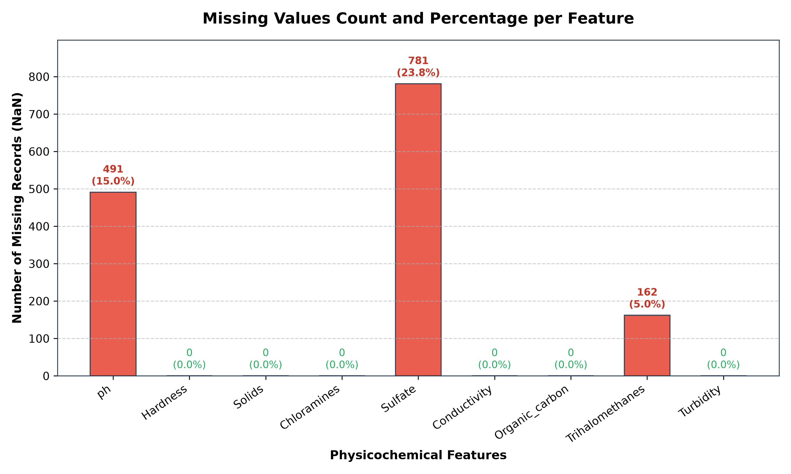
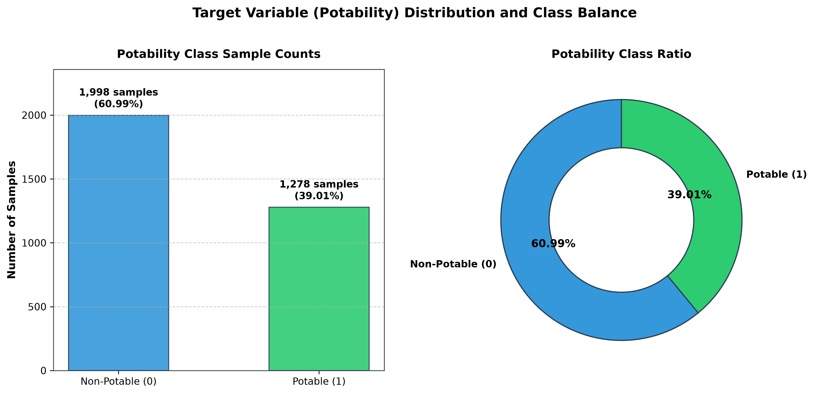
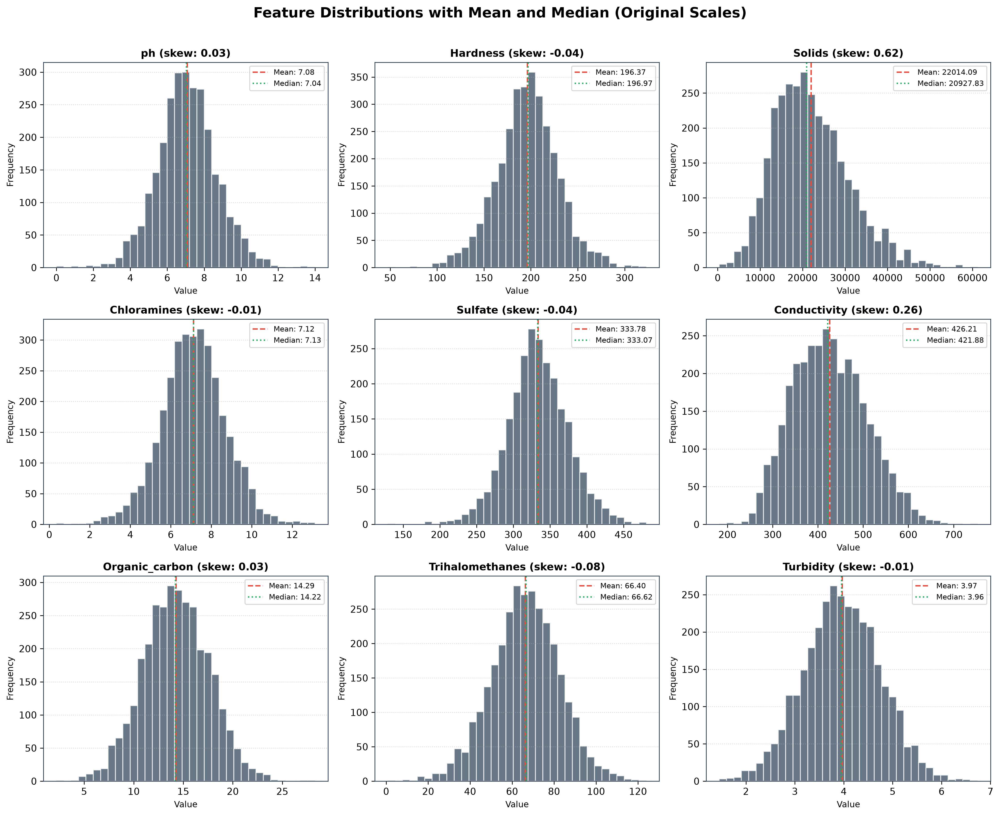
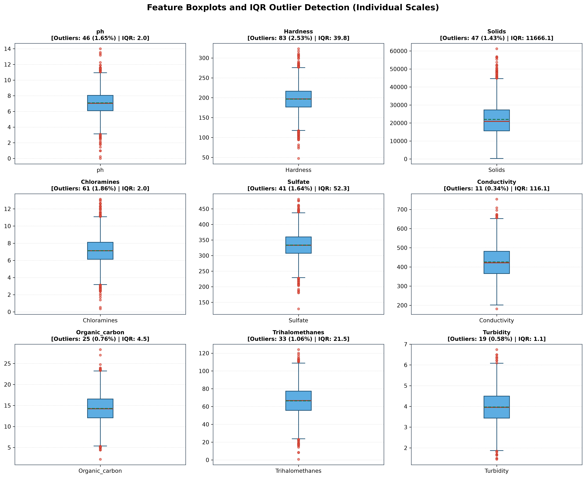
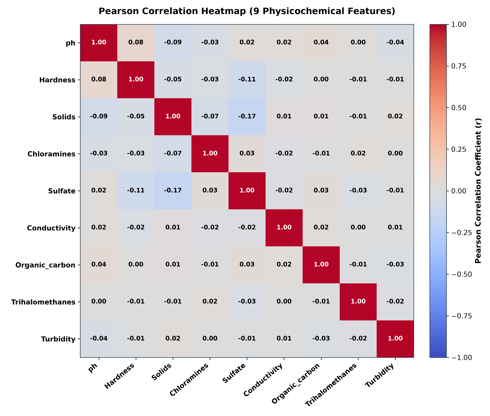
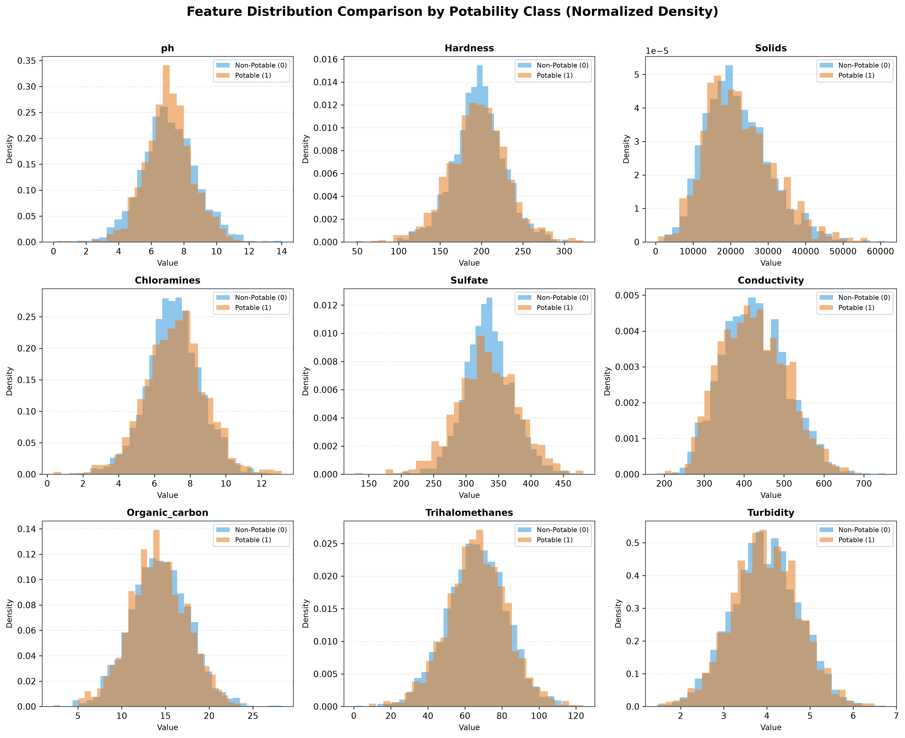

# Phase 2.1: Dataset Exploration and Exploratory Data Analysis (EDA) Report

**Project:** Purity – Water Quality Classification and Potability Prediction System  
**Academic Context:** Tribhuvan University, BCA 8th Semester, Project III  
**Dataset:** Kaggle Water Potability Dataset (`data/water_potability.csv`)  
**Execution Environment:** Python 3.13.9, NumPy, Pandas, Matplotlib (Strictly No Scikit-Learn)

---

## 1. Dataset Overview

The dataset was validated and loaded through `backend/ml/eda.py` without modifying the original source file.

- **Total Water Samples (Rows):** 3,276
- **Total Columns:** 10 (9 Physicochemical Feature Columns + 1 Binary Target Column)
- **Feature Schema Order:** `ph`, `Hardness`, `Solids`, `Chloramines`, `Sulfate`, `Conductivity`, `Organic_carbon`, `Trihalomethanes`, `Turbidity`
- **Target Column:** `Potability` (Binary: `0` = Non-potable, `1` = Potable)
- **Numerical Columns:** 10 / 10
- **Non-Numerical Columns:** 0
- **Memory Footprint:** 256.07 KB (262,212 bytes)
- **Column Data Types:** All 9 physicochemical parameters are 64-bit floating point numbers (`float64`), and the target variable is 64-bit integer (`int64`).

---

## 2. Descriptive Statistics

All descriptive metrics were calculated using Pandas and NumPy directly from the unscaled raw data.

| Feature | Count | Mean | Std Dev | Min | 25% (Q1) | Median | 75% (Q3) | Max | Variance |
| :--- | :--- | :--- | :--- | :--- | :--- | :--- | :--- | :--- | :--- |
| `ph` | 2,785 | 7.081 | 1.594 | 0.000 | 6.093 | 7.037 | 8.062 | 14.000 | 2.542 |
| `Hardness` | 3,276 | 196.369 | 32.880 | 47.432 | 176.851 | 196.968 | 216.667 | 323.124 | 1081.079 |
| `Solids` | 3,276 | 22014.092 | 8768.571 | 320.943 | 15666.690 | 20927.834 | 27332.762 | 61227.196 | 76887834.362 |
| `Chloramines` | 3,276 | 7.122 | 1.583 | 0.352 | 6.127 | 7.130 | 8.115 | 13.127 | 2.506 |
| `Sulfate` | 2,495 | 333.776 | 41.417 | 129.000 | 307.700 | 333.074 | 359.950 | 481.031 | 1715.355 |
| `Conductivity` | 3,276 | 426.205 | 80.824 | 181.484 | 365.734 | 421.885 | 481.792 | 753.343 | 6532.529 |
| `Organic_carbon` | 3,276 | 14.285 | 3.308 | 2.200 | 12.066 | 14.218 | 16.558 | 28.300 | 10.944 |
| `Trihalomethanes` | 3,114 | 66.396 | 16.175 | 0.738 | 55.844 | 66.623 | 77.338 | 124.000 | 261.631 |
| `Turbidity` | 3,276 | 3.967 | 0.780 | 1.450 | 3.440 | 3.955 | 4.500 | 6.739 | 0.609 |

---

## 3. Missing-Value Analysis

### Summary of Missing Values

- **Total Missing Entries:** 1,434 across 3,276 observations.
- **Complete Observations (no missing values):** 2,011 (61.39% of dataset).
- **Incomplete Observations (at least one missing value):** 1,265 (38.61% of dataset).

### Column Breakdown

| Column | Missing Count | Missing (%) | Status |
| :--- | :--- | :--- | :--- |
| `ph` | 491 | 14.99% | Yes (Requires Attention) |
| `Hardness` | 0 | 0.00% | No (Complete) |
| `Solids` | 0 | 0.00% | No (Complete) |
| `Chloramines` | 0 | 0.00% | No (Complete) |
| `Sulfate` | 781 | 23.84% | Yes (Requires Attention) |
| `Conductivity` | 0 | 0.00% | No (Complete) |
| `Organic_carbon` | 0 | 0.00% | No (Complete) |
| `Trihalomethanes` | 162 | 4.95% | Yes (Requires Attention) |
| `Turbidity` | 0 | 0.00% | No (Complete) |
| `Potability` | 0 | 0.00% | No (Complete) |

### Key Observations
1. **Sulfate** exhibits the highest missingness: **781 missing records** (23.84%).
2. **ph** exhibits significant missingness: **491 missing records** (14.99%).
3. **Trihalomethanes** has moderate missingness: **162 missing records** (4.95%).
4. The remaining six features (`Hardness`, `Solids`, `Chloramines`, `Conductivity`, `Organic_carbon`, `Turbidity`) and the target variable `Potability` have **zero missing values**.
5. Dropping incomplete records outright would discard 38.61% of the data, which would degrade sample diversity. Imputation strategies must be evaluated carefully during Phase 2.2.

---

## 4. Target-Class Distribution Analysis

### Class Distribution Metrics

- **Class 0 (Non-Potable):** 1,998 samples (60.99%)
- **Class 1 (Potable):** 1,278 samples (39.01%)
- **Total Validated Samples:** 3,276
- **Class Ratio (Majority : Minority):** 1.563 : 1
- **Absolute Percentage Difference:** 21.98%

### Class Imbalance Implications
- **Majority Class:** Non-potable (`0`) comprises ~61% of records.
- **Minority Class:** Potable (`1`) comprises ~39% of records.
- **Impact on Evaluation:** A naive classifier that predicts non-potable for every sample would attain approximately 61% accuracy without learning water quality characteristics. Therefore, overall accuracy alone is an insufficient evaluation metric. Precision, Recall, F1-Score, and ROC-AUC must be monitored, and stratified partitioning must be employed during data splitting to maintain identical class ratios in training and testing subsets.

---

## 5. Individual Feature Distribution Findings

### Observations
1. **Symmetry and Skewness Profile:** Seven of the nine features (`ph`, `Hardness`, `Chloramines`, `Sulfate`, `Organic_carbon`, `Trihalomethanes`, `Turbidity`) exhibit relatively low absolute skewness values below 0.10. While low skewness suggests relatively symmetrical empirical distributions around their central values, skewness alone does not establish that a feature follows a normal or Gaussian distribution. Distribution shapes should also be examined through the generated histograms. Normality cannot be claimed without formal normality analysis.
2. **Positively Skewed Features:**
   - `Solids` shows positive skewness of approximately +0.62, with an extended upper tail reaching 61,227.20 ppm.
   - `Conductivity` shows positive skewness of approximately +0.26, with an upper tail extending toward 753.34 μS/cm.
3. **Mean vs. Median Proximity:** Across all nine features, the sample mean and median values remain closely positioned, reflecting the relative symmetry observed in the majority of variables.

---

## 6. Outlier Exploration (IQR Method)

Outliers were identified using the non-parametric Interquartile Range method ($IQR = Q_3 - Q_1$, bounds $[Q_1 - 1.5 \times IQR, Q_3 + 1.5 \times IQR]$).

| Feature | Q1 | Q3 | IQR | Valid Range Bounds | Low Outliers | High Outliers | Total Outliers | Outlier (%) |
| :--- | :--- | :--- | :--- | :--- | :--- | :--- | :--- | :--- |
| `ph` | 6.09 | 8.06 | 1.97 | [3.14, 11.02] | 21 | 25 | 46 | 1.65% |
| `Hardness` | 176.85 | 216.67 | 39.82 | [117.13, 276.39] | 44 | 39 | 83 | 2.53% |
| `Solids` | 15666.69 | 27332.76 | 11666.07 | [-1832.42, 44831.87] | 0 | 47 | 47 | 1.43% |
| `Chloramines` | 6.13 | 8.11 | 1.99 | [3.15, 11.10] | 31 | 30 | 61 | 1.86% |
| `Sulfate` | 307.70 | 359.95 | 52.25 | [229.32, 438.33] | 21 | 20 | 41 | 1.64% |
| `Conductivity` | 365.73 | 481.79 | 116.06 | [191.65, 655.88] | 1 | 10 | 11 | 0.34% |
| `Organic_carbon` | 12.07 | 16.56 | 4.49 | [5.33, 23.30] | 13 | 12 | 25 | 0.76% |
| `Trihalomethanes` | 55.84 | 77.34 | 21.49 | [23.61, 109.58] | 19 | 14 | 33 | 1.06% |
| `Turbidity` | 3.44 | 4.50 | 1.06 | [1.85, 6.09] | 10 | 9 | 19 | 0.58% |

### Key Observations
1. **Statistical Nature of IQR Detection:** The Interquartile Range method identifies observations falling outside the $1.5 \times IQR$ boundaries as statistically unusual. An IQR outlier is not automatically a data-recording error, nor is it automatically confirmed to be a genuine natural water variation. The IQR rule serves strictly as an analytical screening mechanism.
2. **Outlier Counts Across Features:**
   - `Hardness` exhibits the highest count of statistical outliers (83 samples, 2.53%), distributed across both lower (44) and upper (39) boundaries.
   - `Chloramines` exhibits 61 statistical outliers (1.86%), with 31 below the lower bound and 30 above the upper bound.
   - `Solids` exhibits 47 statistical outliers (1.43%), all situated along the upper boundary (above 44,831.87 ppm), consistent with its positive skewness.
   - Overall statistical outlier prevalence ranges between 0.34% (`Conductivity`) and 2.53% (`Hardness`) across the features.
3. **Extreme Boundary Observations (pH Values):** The dataset records pH values ranging from a minimum of **0.000** to a maximum of **14.000**. In natural water systems, pH 0 (extreme acidity) and pH 14 (extreme alkalinity) represent extreme boundary observations. These observations require further investigation using water-quality domain knowledge and source documentation. They should not be automatically removed, replaced, or classified as corrupted or invalid at this stage.
4. **Outlier Treatment Policy:** All original observations remain strictly unchanged at this stage. No outlier treatment (such as Winsorization, robust scaling, trimming, or sample deletion) is presented as a predetermined strategy. Outlier treatment decisions will be considered only after domain investigation and, where justified, comparative sensitivity analysis during preprocessing.

---

## 7. Feature Correlation Analysis

### Pairwise Feature Correlation Summary
The Pearson correlation coefficients among all 9 physicochemical parameters are remarkably low:
- Maximum positive correlation: `ph` and `Hardness` ($r = +0.082$)
- Maximum negative correlation: `Sulfate` and `Hardness` ($r = -0.107$)
- All pairwise feature correlations fall strictly within the narrow interval of **[-0.11, +0.08]**.

### Correlation with Potability Target

| Feature | Pearson $r$ with Potability |
| :--- | :--- |
| `ph` | -0.0036 |
| `Hardness` | -0.0138 |
| `Solids` | +0.0337 |
| `Chloramines` | +0.0238 |
| `Sulfate` | -0.0236 |
| `Conductivity` | -0.0081 |
| `Organic_carbon` | -0.0300 |
| `Trihalomethanes` | +0.0071 |
| `Turbidity` | +0.0016 |

### Interpretation
1. **Weak Pairwise Linear Relationships:** Pearson correlation coefficients among the nine physicochemical parameters fall strictly within the narrow range of **[-0.107, +0.082]**. These values indicate weak pairwise linear associations, demonstrating an absence of linear multicollinearity among input features.
2. **Weak Feature-Target Linear Correlations:** Individual Pearson correlations between input features and the binary `Potability` target are also weak ($|r| < 0.035$ for all nine parameters).
3. **Analytical Limits of Linear Correlation:** Weak individual linear correlations do not prove that features lack predictive value. Pearson's $r$ evaluates only bivariate linear relationships; it does not capture every possible non-linear relationship or complex combination of features.
4. **Premature Algorithm Assumptions Avoided:** It is premature to conclude that non-linear feature interaction modeling is strictly required or that linear models will be ineffective based solely on correlation analysis. The actual predictive usefulness of the features and the relative performance of the approved algorithms—Logistic Regression, Support Vector Machine (SVM), and Random Forest—must be determined through subsequent training and evaluation. No algorithm is favored or dismissed based solely on these correlation findings.

---

## 8. Feature Distribution by Potability Class

| Feature | Non-Potable Mean | Potable Mean | Difference (Potable - Non-Potable) | Non-Potable Median | Potable Median |
| :--- | :--- | :--- | :--- | :--- | :--- |
| `ph` | 7.085 | 7.074 | -0.012 | 7.035 | 7.037 |
| `Hardness` | 196.733 | 195.801 | -0.932 | 197.123 | 196.633 |
| `Solids` | 21777.491 | 22383.991 | +606.500 | 20809.618 | 21199.387 |
| `Chloramines` | 7.092 | 7.169 | +0.077 | 7.090 | 7.215 |
| `Sulfate` | 334.564 | 332.567 | -1.997 | 333.389 | 331.838 |
| `Conductivity` | 426.731 | 425.384 | -1.347 | 422.229 | 420.713 |
| `Organic_carbon` | 14.364 | 14.161 | -0.203 | 14.293 | 14.163 |
| `Trihalomethanes` | 66.304 | 66.540 | +0.236 | 66.542 | 66.678 |
| `Turbidity` | 3.966 | 3.968 | +0.003 | 3.948 | 3.959 |

### Observations
1. **Overlapping Densities:** Visualized conditioned on the target class ($Potability = 0$ vs. $Potability = 1$), the marginal density distributions for potable and non-potable samples show substantial overlap across all nine individual features.
2. **Mean & Median Proximity:** The differences in sample means and medians between potable and non-potable subsets are minimal across the dataset.
3. **Implications for Evaluation:** While individual univariate distributions do not show distinct separation between classes, the predictive value of multidimensional feature combinations must be evaluated through model training across the approved classification algorithms.

---

## 9. Preprocessing Recommendations for Subsequent Phases

Based on the empirical findings of Phase 2.1, the following considerations are recommended for Phase 2.2 (Data Preprocessing):

1. **Missing-Value Imputation Candidates:**
   - Discarding incomplete records outright would discard 38.61% of data (1,265 samples), which would substantially reduce sample size.
   - Mean and median imputation are both potential candidate approaches for features with missing values (`Sulfate`, `ph`, `Trihalomethanes`).
   - Median imputation is less sensitive to extreme boundary values, whereas mean imputation may also be suitable depending on training-data distributions.
   - The final imputation approach should be chosen after comparing both methods where appropriate.
   - Imputation statistics must be computed strictly on training data to prevent data leakage, and the same fitted values must be applied to testing data and future user inputs.
   - Imputation is not implemented during this task.

2. **Feature Scaling Considerations:**
   - The nine physicochemical features operate on substantially different numerical scales:
     - `ph`: 0.000 to 14.000
     - `Solids`: 320.943 to 61,227.196 ppm
     - `Conductivity`: 181.484 to 753.343 μS/cm
     - `Turbidity`: 1.450 to 6.739 NTU
   - Feature scaling is particularly important for distance- and gradient-sensitive algorithms such as Support Vector Machines (SVM) and Logistic Regression.
   - Z-score standardization may be considered as the initial scaling approach.
   - Scaling parameters (mean and standard deviation) must be fitted using training data only and reapplied to testing partitions and inference inputs.
   - The scaling decision should be evaluated appropriately for each selected algorithm.
   - Scaling is not implemented during this task.

3. **Stratified Train-Test Splitting:**
   - The dataset exhibits a class distribution of approximately 60.99% non-potable (`0`) and 39.01% potable (`1`).
   - Manual stratified splitting should be implemented (without Scikit-learn) to maintain consistent class proportions across training, validation, and test partitions.
   - A fixed random seed must be utilized to guarantee reproducibility.
   - Splitting is not implemented during this task.

4. **Outlier Investigation and Handling:**
   - No observations are removed or modified during this EDA phase.
   - IQR boundaries serve as analytical screening indicators rather than definitive filters.
   - Potentially unusual observations (such as boundary pH readings of 0 and 14) will be investigated using domain context.
   - Any future outlier treatment must be empirically justified and evaluated through sensitivity analysis rather than assumed beforehand.
   - Outlier treatment is not implemented during this task.

---

## 10. Conclusion

Phase 2.1 establishes a verified baseline understanding of the Water Potability Dataset while strictly adhering to the no-Scikit-learn constraint and preserving the original dataset without modifications. The analysis highlights key data characteristics to address in preprocessing: substantial missingness across three features, wide variance in measurement scales, moderate class imbalance (~61% : 39%), and weak pairwise linear correlations. All verified numerical results and analytical indicators remain intact, providing an objective foundation for exploring preprocessing alternatives in Phase 2.2.
